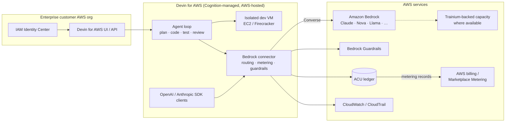

# Architecture

## Request flow vs money flow

| Flow | Path |
|---|---|
| Request | agent → connector → `bedrock-runtime:Converse` → model → connector → agent |
| Metering | each call → tokens × Bedrock price → AWS COGS → ACUs (ledger) |
| Customer billing | ACUs × ACU price → AWS bill (first-party SKU or Marketplace metering) |
| AWS revenue share | % of customer ACU revenue, kept by AWS |
| Cognition infra bill | Bedrock + agent runtime + other AWS services, paid by Cognition to AWS |

## Components in this repo

| Module | Role |
|---|---|
| `bedrock_connector/bedrock.py` | Converse client. Auth via Bedrock API key (`AWS_BEARER_TOKEN_BEDROCK`) or the IAM chain. Retries, Guardrails. Mock client for offline runs. |
| `bedrock_connector/router.py` | Role → model routing (planner / coder / reviewer / fast). Any unknown model name is still served by Bedrock. |
| `bedrock_connector/translate.py` | OpenAI Chat Completions and Anthropic Messages ↔ Converse, including tool calls and SSE. |
| `bedrock_connector/metering.py` | Tokens → USD → ACUs, plus a value-pool split with no double counting. |
| `bedrock_connector/agent.py` | Minimal autonomous coding agent (plan → tool loop → review). |
| `bedrock_connector/gateway.py` | FastAPI app: `/v1/chat/completions`, `/v1/messages`, `/v1/agent/sessions`, `/v1/stats`, dashboard. |

## What production "Devin for AWS" would add

- Deploy into a dedicated AWS account/VPC per region; Bedrock reached via a VPC interface endpoint (PrivateLink).
- IAM roles (not long-term API keys); IAM Identity Center for customer SSO.
- Bedrock AgentCore where it fits: Identity (outbound OAuth to GitHub/Jira), Gateway (tool/MCP connectivity), Observability. Devin keeps its own sandbox VMs and orchestration.
- ACU records → AWS Marketplace Metering Service, or a first-party AWS billing SKU.
- Cross-region inference profiles and provisioned throughput for capacity; Trainium-backed capacity where Bedrock offers it.
