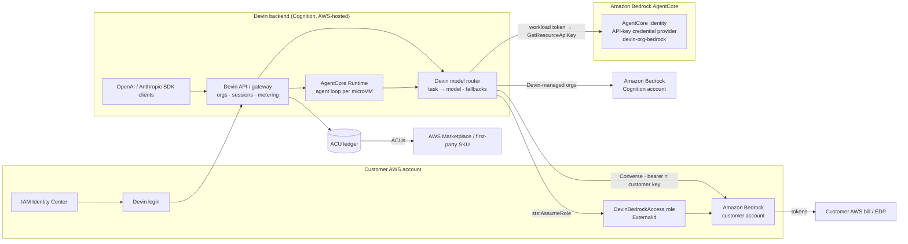

# Architecture

## Sign-in → credentials → routing → Bedrock

1. **Login.** The user signs in to Devin (IAM Identity Center / OIDC; simulated by email
   domain here). The org's settings decide whose Bedrock account serves inference; a new
   org defaults to **its own Bedrock API key**.
2. **Credential custody.** The key is written once to **AgentCore Identity**
   (`CreateApiKeyCredentialProvider`, name `devin-<org>-bedrock`). Devin stores only the
   last four characters for display. At run time the backend gets a workload access token
   for the user (`GetWorkloadAccessTokenForUserId`; inside AgentCore Runtime it arrives with
   the request) and exchanges it for the key (`GetResourceApiKey`). Each Bedrock client is
   built with that tenant's key as its bearer token, never a process-wide env var.
3. **Devin-managed routing.** `ModelRouter.candidates(role, org)` returns the primary model
   per task (planner / coder / reviewer / fast) plus fallbacks (`global.` cross-region
   profiles, then Nova). `InferenceService` tries them in order on throttling, capacity or
   model-access errors and records any fallback. Orgs can pin their own list instead.
4. **Execution.** With `AGENTCORE_RUNTIME_ARN` set, each agent session is sent to
   AgentCore Runtime (`InvokeAgentRuntime` with `runtimeUserId` = the signed-in user), which
   runs `agentcore_app.py` in its own microVM and returns the steps and metered calls.
5. **Billing.** Customer-credential calls are billed by AWS to the customer's account (and
   count toward their commitment); Devin charges ACUs for the agent. Devin-managed calls are
   included in ACUs.

## Request flow vs money flow

| Flow | Path |
|---|---|
| Request | agent → connector → `bedrock-runtime:Converse` → model → connector → agent |
| Metering | each call → tokens × Bedrock price → AWS COGS → ACUs (ledger) |
| Customer billing | ACUs × ACU price → AWS bill (first-party SKU or Marketplace metering) |
| AWS revenue share | % of customer ACU revenue, kept by AWS |
| Cognition infra bill | Bedrock + agent runtime + other AWS services, paid by Cognition to AWS |

## Components in this repo

| Module | Role |
|---|---|
| `bedrock_connector/bedrock.py` | Converse client. Auth via Bedrock API key (`AWS_BEARER_TOKEN_BEDROCK`) or the IAM chain. Retries, Guardrails. Mock client for offline runs. |
| `bedrock_connector/router.py` | Role → model routing (planner / coder / reviewer / fast). Any unknown model name is still served by Bedrock. |
| `bedrock_connector/translate.py` | OpenAI Chat Completions and Anthropic Messages ↔ Converse, including tool calls and SSE. |
| `bedrock_connector/metering.py` | Tokens → USD → ACUs, plus a value-pool split with no double counting. |
| `bedrock_connector/agent.py` | Minimal autonomous coding agent (plan → tool loop → review). |
| `bedrock_connector/tenancy.py` | Orgs, users, simulated SSO login, credential source per org. |
| `bedrock_connector/identity.py` | Credential vaults: AgentCore Identity (API-key credential providers + workload tokens) and a local stand-in. |
| `bedrock_connector/inference.py` | Devin inference backend: per-org Bedrock client (key / assumed role / Devin-managed), routing with fallbacks, metering. |
| `bedrock_connector/runtime.py`, `agentcore_app.py` | Run sessions locally or on AgentCore Runtime (`BedrockAgentCoreApp` entrypoint). |
| `bedrock_connector/gateway.py` | FastAPI app: `/v1/chat/completions`, `/v1/messages`, `/v1/agent/sessions`, `/v1/stats`, dashboard. |

## What production "Devin for AWS" would add

- Deploy into a dedicated AWS account/VPC per region; Bedrock reached via a VPC interface endpoint (PrivateLink).
- IAM roles (not long-term API keys); IAM Identity Center for customer SSO.
- More of AgentCore: Identity OAuth providers for GitHub/Jira, Gateway for tool/MCP connectivity, Memory, Observability (OTEL → CloudWatch).
- ACU records → AWS Marketplace Metering Service, or a first-party AWS billing SKU.
- Cross-region inference profiles and provisioned throughput for capacity; Trainium-backed capacity where Bedrock offers it.
